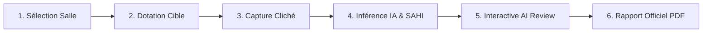

# EPITA SmartScan — Intelligent Classroom Auditing & Vision Artificielle

> **Application progressive (PWA) d'audit intelligent des salles de cours par Vision Artificielle embarquée, révision interactive (Human-in-the-Loop) et explicabilité algorithmique.**  
> Projet développé dans le cadre de l'examen final **EPITA — IA for Managers (Majeure GITM)**.

[](https://vitejs.dev/)
[](https://react.dev/)
[](https://www.typescriptlang.org/)
[](https://www.tensorflow.org/js)
[](https://tailwindcss.com/)
[](https://epita-smartscan.pages.dev/)
[](https://aurelienkb.github.io/epita-smart-classroom/)

---

## 🌐 Déploiements Publics en Ligne

L'application est accessible et vérifiée sur deux environnements de production indépendants :

1. ⚡ **Cloudflare Pages (Livrable d'Examen Prioritaire) :**  
   👉 **[https://epita-smartscan.pages.dev/](https://epita-smartscan.pages.dev/)**
2. 🚀 **GitHub Pages (Redondance CI/CD) :**  
   👉 **[https://aurelienkb.github.io/epita-smart-classroom/](https://aurelienkb.github.io/epita-smart-classroom/)**

---

## 📸 Présentation & Concept Produit

**EPITA SmartScan** transforme la gestion d'infrastructure universitaire en remplaçant les inventaires manuels fastidieux par un parcours guidé en 6 étapes assisté par vision artificielle et contrôle humain :



---

## 🌟 Fonctionnalités Majeures

### 1. 🎯 Interactive AI Review (Contrôle et Correction Humaine)
- **Sélection directe sur l'image :** Cliquez ou touchez n'importe quel objet sur le canvas pour inspecter sa boîte englobante.
- **Panneau inspecteur complet :** Visualisation de la classe originale prédite par l'IA, du score de confiance et du statut.
- **Actions immédiates en 1 clic :**
  - **Confirmer :** Valide la détection (bordure émeraude).
  - **Rejeter (Faux positif) :** Élimine une erreur de détection (bordure rouge hachurée) et décrémente les compteurs.
  - **Reclassifier :** Corrige une mauvaise catégorie (ex. table confondue avec un bureau) parmi les catégories autorisées du campus.
  - **Réinitialiser :** Restaure la prédiction initiale de l'IA.
- **Séparation stricte et déontologique :** Les prédictions brutes du modèle, les actions de révision humaine et l'inventaire consolidé sont rigoureusement distingués dans la matrice.

### 2. 🛡️ AI Reliability Center (Centre de Fiabilité & Explicabilité)
- **Distribution des scores :** Répartition des détections par tiers de confiance (<40%, 40-70%, $\ge 70\%$).
- **Pédagogie algorithmique :** Rappel clair que les scores du modèle sont des activations relatives de réseau de neurones et non des probabilités calibrées de vérité terrain.
- **Bilan d'ontologie :** Distingue les classes prises en charge par le modèle (chaises, tables, ordinateurs, tableaux) des classes non supportées nécessitant une vérification in-situ (fenêtres, projecteurs).
- **Limites d'occultation 2D :** Analyse des perspectives et conseils de cadrage.

### 3. 🔬 Vision Artificielle Avancée
- **Inférence 100% Client-Side :** TensorFlow.js et COCO-SSD (MobileNet v2) exécutés directement sur le GPU client via WebGL (zéro latence réseau, zéro coût serveur).
- **Tuilage Haute Résolution (SAHI) :** Slicing Aided Hyper Inference découpant l'image en 4 quadrants pour détecter les équipements éloignés avec une résolution 4x supérieure.
- **Boost IA Adaptatif :** Égalisation locale de l'histogramme pour détacher le mobilier sombre sur sol foncé.
- **Détection des Tableaux de Classe :** Détecteur dédié par analyse géométrique et homogénéité de réflectance.
- **Filtrage Éthique RGPD :** Détection et exclusion automatique de la classe `person` (zéro analyse biométrique, zéro suivi humain).

### 4. 📋 Rapport d'Infrastructure Professionnel
- **Format Livrable Universitaire :** Document officiel structuré avec synthèse exécutive, matrice tripartite détaillée et bloc de signature formel.
- **Recommandations Déterministes :** Préconisations générées par règles logiques strictes selon les écarts constatés.
- **Mise en page d'impression :** Feuille de style dédiée `@media print` pour une exportation PDF propre et paginée.

---

## 🛠️ Stack Technique

- **Frontend :** React 18, TypeScript, Vite 5.
- **Design System :** Tailwind CSS avec thème sombre institutionnel (`#0B1020`, `#151D30`, cyan `#38D9E6`, émeraude `#34D399`).
- **Composants & Icônes :** Lucide React.
- **Vision Artificielle :** `@tensorflow/tfjs` 4.22 + `@tensorflow-models/coco-ssd` 2.2.3.
- **Hébergement :** Cloudflare Pages & GitHub Pages.

---

## 💻 Démarrage en Local

### 1. Prérequis
- **Node.js** (v18+ ou v20+ recommandé)
- **NPM**

### 2. Installation
```bash
git clone https://github.com/Aurelienkb/epita-smart-classroom.git
cd epita-smart-classroom
npm install
```

### 3. Lancement du serveur de développement
```bash
npm run dev
```
L'application démarre immédiatement sur `http://localhost:5173`.

### 4. Compilation de production
```bash
npm run build
```
Le bundle statique optimisé est généré dans le dossier `dist/`.

---

## ☁️ Configuration & Déploiement Cloudflare Pages

Le projet dispose d'une configuration prête à l'emploi pour Cloudflare Pages :

1. Connectez votre compte GitHub sur [dash.cloudflare.com](https://dash.cloudflare.com/).
2. Sélectionnez **Workers & Pages** › **Create application** › **Pages** › **Connect to Git**.
3. Choisissez le dépôt `epita-smart-classroom`.
4. Paramètres de compilation :
   - **Framework preset :** `Vite`
   - **Build command :** `npm run build`
   - **Build output directory :** `dist`
   - **Production branch :** `main`
5. Cliquez sur **Save and Deploy**.
6. Cloudflare déploie le site sur le CDN Edge mondial sous l'URL `https://epita-smartscan.pages.dev/`.

---

## 📄 Dossier de Projet Complet

Pour l'évaluation académique, consultez le dossier de gestion de projet complet dans [`PROJECT_REPORT.md`](./PROJECT_REPORT.md) :
- Problématique métier, parties prenantes et utilisateurs cibles.
- Périmètre MVP et nouvelles fonctionnalités.
- Backlog des User Stories et critères d'acceptation.
- Planning et KPIs documentés avec mesures effectives.
- Protocole de test sur situations critiques.
- Registre des risques, éthique et conformité RGPD.

---
*EPITA — École pour l'Informatique et les Techniques Avancées · Spécialisation GITM · Octobre 2026*
